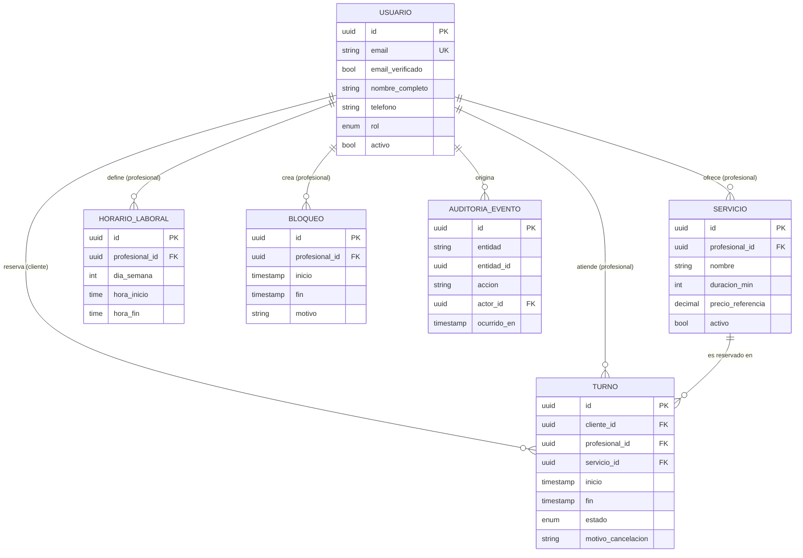

# spec.md — Sistema de Gestión de Turnos y Reservas de Servicios Profesionales

| Campo | Valor |
|---|---|
| Versión | 0.4.2 (Fase 3, cierre: agentes confiables) |
| Estado | Borrador para revisión |
| Metodología | Spec-Driven Development (SDD) |
| Fecha | 2026-11-24 |
| Cambios respecto de 0.1.0 | Ver §13 (Historial de cambios) |

> Este documento es el **contrato del sistema**. Todo código, test y decisión de diseño debe poder trazarse a una sección de este archivo. Si el código y la spec divergen, se corrige primero la spec y luego el código.

Palabras clave normativas: **DEBE** (obligatorio), **NO DEBE** (prohibido), **PUEDE** (opcional), según RFC 2119.

---

## 1. Alcance del MVP

### 1.1 Objetivo
Permitir que clientes reserven turnos con profesionales para servicios con duración definida, y que los profesionales/administradores gestionen su agenda sin conflictos.

### 1.2 Incluido (In scope)

| ID | Capacidad |
|---|---|
| F-01 | Registro e inicio de sesión de usuarios (email + contraseña). |
| F-02 | Catálogo público de servicios (nombre, descripción, duración, precio de referencia, profesional). |
| F-03 | Consulta de disponibilidad por servicio y fecha (slots libres calculados). |
| F-04 | Reserva de turno por parte del Cliente. |
| F-05 | Consulta de "Mis turnos" (próximos e históricos) del Cliente. |
| F-06 | Cancelación de turno propio por el Cliente (sujeta a RN-01). |
| F-07 | Gestión de servicios por el Profesional (alta, edición, baja lógica). |
| F-08 | Definición de horario laboral semanal recurrente del Profesional. |
| F-09 | Bloqueo de rangos horarios (vacaciones, almuerzo, imprevistos). |
| F-10 | Vista de agenda diaria/semanal con todos los turnos del Profesional. |
| F-11 | Cancelación de turno por el Profesional/Administrador (sin restricción de ventana, con motivo). |
| F-12 | Métricas básicas: turnos por período, tasa de cancelación, servicios más reservados, ocupación. |
| F-13 | Notificación por email de confirmación y cancelación. |

### 1.3 Excluido (Out of scope)

- Pagos en línea, señas, reembolsos y facturación.
- Reprogramación directa de turnos (el MVP resuelve con cancelar + reservar nuevo).
- Turnos recurrentes / paquetes de sesiones.
- Lista de espera.
- Múltiples sucursales o recursos físicos (salas, equipos).
- Integración con calendarios externos (Google/Outlook), recordatorios por SMS/WhatsApp.
- Login social / SSO, autenticación multifactor.
- Aplicación móvil nativa (el MVP es web responsive).
- Multi-idioma y multi-moneda (MVP: español, una moneda).
- Reseñas y calificaciones.
- Multi-tenancy (una sola organización por despliegue).

### 1.4 Supuestos

- Una única zona horaria de operación por despliegue (configurable); los instantes se almacenan en UTC.
- Un turno pertenece a **un** profesional y **un** servicio.
- Un profesional atiende un solo turno a la vez (capacidad = 1).
- El cliente final reserva con cuenta registrada (no hay reserva anónima).

---

## 2. Matriz de Roles y Permisos (RBAC)

### 2.1 Roles

| Rol | Descripción |
|---|---|
| `CLIENTE` | Usuario final que reserva servicios. |
| `PROFESIONAL` | Presta servicios; administra su propia agenda y servicios. |
| `ADMIN` | Gestiona toda la operación: todos los profesionales, servicios y usuarios. |
| Anónimo | Visitante sin sesión (solo lectura del catálogo). |

> Para el MVP, `PROFESIONAL` y `ADMIN` comparten el panel de gestión; `ADMIN` amplía el alcance a **todos** los profesionales.

### 2.2 Matriz de permisos

Leyenda: ✅ permitido · ❌ prohibido · 🔒 solo sobre recursos propios

| Recurso / Acción | Anónimo | CLIENTE | PROFESIONAL | ADMIN |
|---|:-:|:-:|:-:|:-:|
| Ver catálogo de servicios | ✅ | ✅ | ✅ | ✅ |
| Ver disponibilidad (slots libres) | ✅ | ✅ | ✅ | ✅ |
| Registrarse / iniciar sesión | ✅ | — | — | — |
| Crear turno | ❌ | ✅ (para sí) | ❌ | ✅ (en nombre de un cliente) |
| Ver turno | ❌ | 🔒 | 🔒 (de su agenda) | ✅ |
| Cancelar turno | ❌ | 🔒 (sujeto a RN-01) | 🔒 (sin ventana mínima) | ✅ (sin ventana mínima) |
| Editar datos de contacto propios | ❌ | 🔒 | 🔒 | ✅ |
| Crear/editar/desactivar servicios | ❌ | ❌ | 🔒 | ✅ |
| Definir horario laboral | ❌ | ❌ | 🔒 | ✅ |
| Bloquear / desbloquear rangos horarios | ❌ | ❌ | 🔒 | ✅ |
| Ver agenda completa | ❌ | ❌ | 🔒 | ✅ |
| Ver métricas | ❌ | ❌ | 🔒 (propias) | ✅ (globales) |
| Gestionar usuarios y roles | ❌ | ❌ | ❌ | ✅ |

### 2.3 Reglas de autorización

- **RBAC-01**: Toda operación DEBE verificar rol **y** propiedad del recurso en el backend; la UI nunca es la barrera de seguridad.
- **RBAC-02**: Un acceso a un recurso ajeno DEBE responder `404` (no `403`) para no revelar su existencia a un `CLIENTE`.
- **RBAC-03**: El rol se asigna únicamente por un `ADMIN`; el auto-registro siempre crea `CLIENTE`.
- **RBAC-04**: Un `CLIENTE` NO DEBE poder ver datos de contacto de otros clientes. El `PROFESIONAL` solo ve los datos de contacto de clientes con turnos en su agenda.

---

## 3. Reglas Invariantes del Negocio

Las siguientes reglas son **no negociables**: se validan en el backend, y la base de datos DEBE reforzarlas con restricciones cuando sea técnicamente posible. Ninguna regla puede ser omitida por la UI ni por un rol (salvo excepción explícita indicada).

> **Nomenclatura INV.** A partir de la v0.2.0 las reglas que gobiernan el backend también se citan como `INV-xx`. `INV-01` ≡ `RN-01` e `INV-02` ≡ `RN-02`: son alias y su texto es **inmutable** (no se modifica en esta versión). `INV-03` es nueva (ver más abajo). Las demás reglas RN-03 a RN-08 siguen vigentes sin cambios.

### RN-01 (INV-01) — Ventana mínima de cancelación

- Un `CLIENTE` NO DEBE cancelar un turno si faltan **menos de 2 horas** para su `inicio`.
- Valor configurable (`CANCELLATION_WINDOW_HOURS`, default `2`); el cálculo usa `inicio - ahora(UTC)`.
- Un turno ya iniciado, finalizado o cancelado NO DEBE ser cancelable.
- **Excepción**: `PROFESIONAL`/`ADMIN` PUEDEN cancelar fuera de ventana, con motivo obligatorio, y el cliente DEBE ser notificado.
- Respuesta ante violación: error `CANCELLATION_WINDOW_EXPIRED` (HTTP 409).

### RN-02 (INV-02) — Prohibición de doble reserva y solapamiento

- Para un mismo profesional, dos turnos en estado activo (`CONFIRMADO`) NO DEBEN solaparse en el tiempo.
- Se define el solapamiento sobre intervalos semiabiertos `[inicio, fin)`: dos turnos A y B se solapan si `A.inicio < B.fin` **y** `B.inicio < A.fin`. Turnos contiguos (`A.fin == B.inicio`) son válidos.
- Un turno NO DEBE solaparse con un bloqueo horario (RN-05) ni quedar fuera del horario laboral del profesional.
- Un mismo cliente NO DEBE tener dos turnos activos solapados (aunque sean con distintos profesionales).
- **Garantía ante concurrencia**: la verificación DEBE ser atómica. Se exige restricción a nivel de base de datos (p. ej. `EXCLUDE USING gist` sobre rango temporal por profesional en PostgreSQL, o transacción con bloqueo + índice único equivalente). Una validación solo en la aplicación NO es suficiente.
- Los turnos `CANCELADO` NO participan del control de solapamiento (el slot se libera).
- Respuesta ante violación: error `SLOT_UNAVAILABLE` (HTTP 409).

### RN-03 — Validación obligatoria de datos de contacto

- Para crear un turno, el `CLIENTE` DEBE tener un perfil con: **nombre completo** (2–100 caracteres), **email válido** (RFC 5322 simplificado, único por usuario) y **teléfono** válido en formato E.164 o equivalente local normalizado.
- El email DEBE estar **verificado** (enlace de confirmación) antes de la primera reserva.
- La reserva NO DEBE persistirse si algún dato de contacto falta o es inválido (error `INVALID_CONTACT`, HTTP 422).
- Los datos se normalizan (trim, minúsculas en email, teléfono a E.164) antes de validar y guardar.

### RN-04 — Integridad temporal del turno

- `inicio` DEBE ser estrictamente futuro respecto a `ahora` al momento de crear el turno, con una **antelación mínima** configurable (default: 1 hora).
- `fin = inicio + duración del servicio`; el cliente NO DEBE enviar `fin` (se calcula en servidor).
- El `inicio` DEBE estar alineado a la grilla de slots del profesional (default: 15 min).
- Existe un **horizonte máximo de reserva** (default: 60 días).
- Todos los instantes se almacenan en UTC y se muestran en la zona horaria de operación.

### RN-05 — Bloqueos horarios

- Un bloqueo es un rango `[inicio, fin)` del profesional en el que no se pueden crear turnos.
- Crear un bloqueo sobre un rango con turnos activos DEBE ser rechazado con listado de conflictos, **salvo** que el profesional confirme cancelarlos (lo cual aplica la excepción de RN-01 y notifica a los clientes).

### RN-06 — Ciclo de vida del turno

Estados: `CONFIRMADO` → `CANCELADO` | `COMPLETADO` | `AUSENTE`.

| Transición | Quién | Condición |
|---|---|---|
| (nuevo) → `CONFIRMADO` | Cliente / Admin | Cumple RN-02, RN-03, RN-04 |
| `CONFIRMADO` → `CANCELADO` | Cliente | Cumple RN-01 |
| `CONFIRMADO` → `CANCELADO` | Profesional / Admin | Motivo obligatorio |
| `CONFIRMADO` → `COMPLETADO` | Profesional / Admin | `ahora ≥ inicio` |
| `CONFIRMADO` → `AUSENTE` | Profesional / Admin | `ahora ≥ fin` |

- Los estados `CANCELADO`, `COMPLETADO` y `AUSENTE` son **terminales**; ninguna transición sale de ellos.
- Un turno NO DEBE eliminarse físicamente; el historial es inmutable (solo cambia de estado).

### RN-07 — Integridad de catálogo

- Un servicio con turnos futuros activos NO DEBE eliminarse; solo desactivarse (baja lógica), lo cual impide nuevas reservas sin afectar las existentes.
- La duración de un servicio DEBE ser múltiplo de la grilla de slots y estar entre 15 min y 8 h.
- Modificar la duración de un servicio NO altera turnos ya confirmados.

### RN-08 — Trazabilidad

- Toda creación, cancelación y cambio de estado DEBE registrar: actor, rol, instante UTC y motivo (si aplica) en un log de auditoría inmutable.

### INV-03 — Persistencia real

- Todo turno creado o modificado (creación, cancelación, cambio de estado) DEBE persistirse de forma **atómica** en una base de datos relacional: o se guardan todos los cambios de la operación, o ninguno.
- Los turnos DEBEN sobrevivir al reinicio del sistema (backend y frontend). Ningún dato de dominio puede residir únicamente en la memoria del cliente (navegador) ni del proceso del servidor.
- La verificación de `INV-01` e `INV-02` DEBE ejecutarse **dentro de la misma transacción** que la escritura, de modo que dos solicitudes concurrentes por el mismo horario no puedan confirmarse ambas. En un motor sin restricción de exclusión de rangos (p. ej. SQLite), la atomicidad se logra con transacción de escritura exclusiva (`BEGIN IMMEDIATE`) o un bloqueo equivalente, según lo admite RN-02.
- Si la escritura falla, el sistema DEBE responder error y NO DEBE dejar el turno a medias.
- El esquema DEBE limitarse a las entidades y atributos de la §4 (ver §12, directiva de abstención).

---

## 4. Modelo de Datos Conceptual

### 4.1 Entidades principales

#### Usuario
| Atributo | Tipo | Restricciones |
|---|---|---|
| `id` | UUID | PK |
| `email` | texto | Único, obligatorio, normalizado |
| `email_verificado` | booleano | Default `false` |
| `password_hash` | texto | Obligatorio (nunca en claro) |
| `nombre_completo` | texto | Obligatorio, 2–100 |
| `telefono` | texto | Obligatorio, E.164 |
| `rol` | enum | `CLIENTE` \| `PROFESIONAL` \| `ADMIN` |
| `activo` | booleano | Default `true` |
| `creado_en` | timestamp UTC | |

#### Servicio
| Atributo | Tipo | Restricciones |
|---|---|---|
| `id` | UUID | PK |
| `profesional_id` | UUID | FK → Usuario (rol `PROFESIONAL`) |
| `nombre` | texto | Obligatorio |
| `descripcion` | texto | Opcional |
| `duracion_min` | entero | 15–480, múltiplo de la grilla |
| `precio_referencia` | decimal | ≥ 0, informativo |
| `activo` | booleano | Baja lógica (RN-07) |

#### Turno
| Atributo | Tipo | Restricciones |
|---|---|---|
| `id` | UUID | PK |
| `cliente_id` | UUID | FK → Usuario (rol `CLIENTE`) |
| `profesional_id` | UUID | FK → Usuario (rol `PROFESIONAL`) |
| `servicio_id` | UUID | FK → Servicio |
| `inicio` | timestamp UTC | Futuro al crear (RN-04) |
| `fin` | timestamp UTC | Calculado: `inicio + duración` |
| `estado` | enum | Ver RN-06 |
| `motivo_cancelacion` | texto | Obligatorio si lo cancela Profesional/Admin |
| `cancelado_por_id` | UUID | FK → Usuario, nullable |
| `creado_en` / `actualizado_en` | timestamp UTC | |

*Restricción clave*: exclusión de rangos `[inicio, fin)` por `profesional_id` cuando `estado = CONFIRMADO` (RN-02).

#### Entidades de soporte

| Entidad | Atributos clave | Propósito |
|---|---|---|
| **HorarioLaboral** | `id`, `profesional_id`, `dia_semana` (0–6), `hora_inicio`, `hora_fin` | Disponibilidad semanal recurrente (F-08). |
| **Bloqueo** | `id`, `profesional_id`, `inicio`, `fin`, `motivo` | Rangos no reservables (F-09, RN-05). |
| **AuditoriaEvento** | `id`, `entidad`, `entidad_id`, `accion`, `actor_id`, `rol`, `ocurrido_en`, `detalle` | Trazabilidad inmutable (RN-08). |

#### audit_logs (INV-09)

Registro de ejecuciones del agente. Es **distinta** de `AuditoriaEvento` (RN-08), que audita cambios sobre entidades de dominio: `audit_logs` no la reemplaza ni la implementa.

| Columna | Tipo SQLite | Restricciones | Contenido |
|---|---|---|---|
| `id` | TEXT | PK (UUID) | Identificador de la ejecución. |
| `timestamp` | TEXT | NOT NULL | Inicio de la ejecución, UTC, formato `YYYY-MM-DDTHH:MM:SSZ`. |
| `origen` | TEXT | NOT NULL, CHECK IN (`chat_web`, `webhook_externo`) | Canal que inició la ejecución. |
| `prompt` | TEXT | NOT NULL | Mensaje recibido, sin el prompt del sistema ni el historial. |
| `herramientas` | TEXT | NOT NULL, default `'[]'` | Arreglo JSON con los nombres de las herramientas ejecutadas, en orden y con repeticiones. |
| `pasos` | INTEGER | NOT NULL, CHECK BETWEEN 0 AND 5 | Cantidad de llamadas al modelo (iteraciones del bucle). |
| `latencia_ms` | INTEGER | NOT NULL, CHECK ≥ 0 | Duración total de la ejecución en milisegundos. |
| `estado` | TEXT | NOT NULL, CHECK IN (`ok`, `error`, `circuit_breaker`) | Resultado final (ver INV-09). |

Índice por `timestamp`. Sin claves foráneas: el registro debe poder escribirse aunque la ejecución haya fallado.

#### webhook_logs (INV-07)

Resultado final de cada entrega de webhook saliente (una fila por notificación, no por intento).

| Columna | Tipo SQLite | Restricciones | Contenido |
|---|---|---|---|
| `id` | TEXT | PK (UUID) | Identificador de la entrega. |
| `timestamp` | TEXT | NOT NULL | Momento del resultado final, UTC `YYYY-MM-DDTHH:MM:SSZ`. |
| `evento` | TEXT | NOT NULL | `turno.creado` o `turno.cancelado`. |
| `turno_id` | TEXT | nullable | Turno notificado. |
| `estado` | TEXT | NOT NULL, CHECK IN (`entregado`, `fallido`) | Resultado final. |
| `intentos` | INTEGER | NOT NULL, CHECK BETWEEN 1 AND 4 | Intentos realizados. |
| `codigo_http` | INTEGER | nullable | Último status recibido; nulo si no hubo respuesta. |
| `error` | TEXT | nullable | Tipo del último error. No incluye la URL de destino (puede contener un token). |

### 4.2 Relaciones y cardinalidad

```
Usuario (PROFESIONAL) 1 ──── N Servicio
Usuario (PROFESIONAL) 1 ──── N HorarioLaboral
Usuario (PROFESIONAL) 1 ──── N Bloqueo
Usuario (PROFESIONAL) 1 ──── N Turno      (como profesional atendiendo)
Usuario (CLIENTE)     1 ──── N Turno      (como cliente reservando)
Servicio              1 ──── N Turno
Usuario               1 ──── N AuditoriaEvento (actor)
```



### 4.3 Invariantes de integridad referencial

- `Turno.profesional_id` DEBE coincidir con `Servicio.profesional_id` del `servicio_id` asociado.
- `Turno.cliente_id` y `Turno.profesional_id` DEBEN ser usuarios distintos.
- Ninguna FK usa borrado en cascada sobre `Turno`; el historial se preserva (RN-06, RN-07).

---

## 5. Métricas del MVP (F-12)

| Métrica | Definición |
|---|---|
| Turnos por período | Conteo de turnos `CONFIRMADO`/`COMPLETADO` agrupados por día/semana/mes. |
| Tasa de cancelación | `CANCELADO / total creados` en el período, con desglose por quién canceló. |
| Tasa de ausentismo | `AUSENTE / (COMPLETADO + AUSENTE)`. |
| Ocupación | Minutos reservados / minutos disponibles (horario laboral − bloqueos). |
| Top servicios | Ranking de servicios por cantidad de turnos. |

Alcance: el `PROFESIONAL` ve solo las suyas; el `ADMIN` ve las globales y por profesional.

---

## 6. Requisitos No Funcionales (mínimos del MVP)

- **Seguridad**: contraseñas con hash adaptativo (argon2/bcrypt), HTTPS obligatorio, sesiones con expiración, protección CSRF/XSS, rate limiting en login y reserva.
- **Consistencia**: la creación de turno es transaccional y atómica (RN-02).
- **Rendimiento**: consulta de disponibilidad < 500 ms p95 con hasta 50 profesionales.
- **Privacidad**: datos de contacto accesibles solo según RBAC-04; cumplimiento de la normativa local de protección de datos personales.
- **Disponibilidad**: objetivo 99,5 % mensual (sin HA en MVP).
- **Accesibilidad**: WCAG 2.1 AA en flujos de reserva.

---

## 7. Catálogo de Errores de Dominio

| Código | HTTP | Origen |
|---|---|---|
| `SLOT_UNAVAILABLE` | 409 | RN-02, RN-05 |
| `CANCELLATION_WINDOW_EXPIRED` | 409 | RN-01 |
| `INVALID_CONTACT` | 422 | RN-03 |
| `EMAIL_NOT_VERIFIED` | 403 | RN-03 |
| `INVALID_TIME_RANGE` | 422 | RN-04 |
| `INVALID_STATE_TRANSITION` | 409 | RN-06 |
| `SERVICE_HAS_ACTIVE_BOOKINGS` | 409 | RN-07 |
| `FORBIDDEN` / `NOT_FOUND` | 403 / 404 | RBAC-01, RBAC-02 |
| `INVALID_REQUEST` | 422 | §11: cuerpo o parámetros mal formados (validación de esquema, motivo faltante) |
| `AGENT_UNAVAILABLE` | 503 | §15: falta `ANTHROPIC_API_KEY` o el servicio del modelo no responde |

---

## 8. Criterios de Aceptación (muestra Given/When/Then)

1. **Doble reserva**: *Dado* un turno `CONFIRMADO` de 10:00–10:30 con el profesional P, *cuando* otro cliente reserva 10:15–10:45 con P, *entonces* el sistema responde `SLOT_UNAVAILABLE` y no persiste nada.
2. **Concurrencia**: *Dado* dos solicitudes simultáneas por el mismo slot, *entonces* exactamente una se confirma y la otra recibe `SLOT_UNAVAILABLE`.
3. **Contigüidad**: *Dado* un turno 10:00–10:30, *cuando* se reserva 10:30–11:00, *entonces* se confirma.
4. **Cancelación en ventana**: *Dado* un turno que inicia en 3 h, *cuando* el cliente cancela, *entonces* pasa a `CANCELADO` y el slot queda libre.
5. **Cancelación fuera de ventana**: *Dado* un turno que inicia en 1 h 59 min, *cuando* el cliente cancela, *entonces* `CANCELLATION_WINDOW_EXPIRED`.
6. **Contacto inválido**: *Dado* un cliente sin teléfono válido, *cuando* intenta reservar, *entonces* `INVALID_CONTACT`.
7. **Aislamiento**: *Dado* el turno T del cliente A, *cuando* el cliente B consulta T, *entonces* recibe `404`.
8. **Bloqueo con conflicto**: *Dado* un turno confirmado dentro de un rango, *cuando* el profesional intenta bloquearlo sin confirmar, *entonces* el sistema lista los conflictos y no crea el bloqueo.
9. **Persistencia (INV-03)**: *Dado* un turno creado con `POST /api/turnos`, *cuando* se reinicia el backend, *entonces* `GET /api/turnos` lo sigue devolviendo con los mismos datos.
10. **Atomicidad (INV-03)**: *Dado* un fallo durante la escritura de un turno, *entonces* no queda ningún registro parcial en `turnos.db`.
11. **Contrato REST**: *Dado* un `POST /api/turnos/{id}/cancelar` a menos de 2 h del inicio por un `CLIENTE`, *entonces* responde `409` con `CANCELLATION_WINDOW_EXPIRED` y el turno sigue `CONFIRMADO`.

---

## 9. Decisiones Abiertas (a resolver antes de implementar)

| # | Pregunta | Propuesta por defecto |
|---|---|---|
| D-01 | ¿Un cliente puede tener límite de turnos activos simultáneos? | Sin límite en MVP |
| D-02 | ¿Los Profesionales pueden ser dados de alta por auto-registro? | No, solo vía `ADMIN` |
| D-03 | ¿Política de cancelaciones reiteradas / penalización? | Fuera del MVP |
| D-04 | Stack tecnológico y motor de BD (requiere soporte de exclusión de rangos) | PostgreSQL. **Fase 2:** se usa SQLite local (`turnos.db`) y FastAPI; la exclusión de rangos se resuelve por transacción exclusiva (INV-03). PostgreSQL queda como destino de producción. |
| D-06 | Autenticación real (F-01) aún no existe en Fase 2: ¿cómo se identifica al actor en los endpoints? | Provisoriamente por `cliente_id` / `cancelado_por_id` en el cuerpo. Es un atajo de la Fase 2: NO cumple RBAC-01 y se reemplaza al implementar F-01. |
| D-05 | ¿Confirmación automática o aprobación manual del profesional? | Automática |
| D-07 | Proveedor y modelo de LLM del agente (§15) | **Resuelta:** Anthropic, `claude-opus-5-5` (configurable con `ANTHROPIC_MODEL`) |
| D-08 | Modelo de embeddings, tamaño de fragmento (chunk) y valor de K del Top-K (INV-06) | **Resuelta:** embeddings locales por defecto de ChromaDB (all-MiniLM-L6-v2), chunks por sección de hasta ~900 caracteres, K = 4 en el agente (3 por defecto en `buscar_conocimiento`) |
| D-09 | Formatos admitidos por `POST /api/conocimiento` y límite de tamaño | **Resuelta:** `.md` y `.txt` en UTF-8; sin límite de tamaño en esta fase |
| D-10 | ¿El agente tiene memoria de la conversación entre pedidos de `/api/chat`? Si la tiene, ¿dónde se guarda? (la §12 prohíbe tablas fuera de la §4) | **Resuelta:** sin memoria en el servidor; el cliente reenvía el `historial` en cada pedido |
| D-11 | ¿Qué endpoint recibe los webhooks externos que inician al agente (`origen = webhook_externo`)? ¿Con qué cuerpo, autenticación y permisos de escritura? | **Resuelta (§16.5):** `POST /api/webhooks/externo`, sin autenticación (igual que `/api/chat`, D-06) y sin paciente de sesión. La autenticación queda pendiente (D-14) |
| D-12 | ¿El webhook saliente (INV-07) se firma o autentica (p. ej. HMAC)? | **Abierta.** Por defecto sin firma; el cuerpo solo lleva ids, sin datos de contacto |
| D-13 | `audit_logs.prompt` puede contener datos personales: ¿retención y quién puede leerlo? | **Parcial.** Lectura por `GET /api/audit-logs` (últimas 20, sin autenticación en esta fase). Retención y control de acceso siguen abiertos; no desplegar fuera de un entorno local sin resolverlos |
| D-14 | ¿Cómo se autentica el webhook entrante y cómo se vincula `remitente` con un paciente? | **Abierta.** Hoy no se autentica y `remitente` no otorga identidad: no se puede cancelar; sí reservar nombrando a un paciente, igual que en `/api/chat` sin `cliente_id` |

---

## 10. Trazabilidad (Spec → Código → Test)

| Spec | Código (a completar) | Test (a completar) |
|---|---|---|
| RN-01 | — | Criterios 4, 5 |
| RN-02 | — | Criterios 1, 2, 3 |
| RN-03 | — | Criterio 6 |
| RBAC-02 | — | Criterio 7 |
| INV-03 | — | Criterios 9, 10 |
| RN-05 | — | Criterio 8 |
| INV-04 | — | Criterios 12, 13 (§15.4) |
| INV-05 | — | Criterios 14, 15 (§15.4) |
| INV-06 | — | Criterios 16, 17, 18 (§15.4) |
| INV-07 | `webhooks.py`; `main.programar_notificacion`, `main.procesar_webhook_externo` | Criterios 19, 20, 21 (§16.4) |
| INV-08 | `agent.ejecutar_agente` | Criterios 22, 23 (§16.4) |
| INV-09 | `main.registrar_auditoria`; `agent.ejecutar_agente`; `GET /api/audit-logs` | Criterios 24, 25 (§16.4) |

---

## 11. Contrato de API REST (Fase 2)

Este contrato gobierna el backend. Formato JSON (`Content-Type: application/json`), instantes en ISO 8601 UTC. Los nombres de campo son **exactamente** los de la §4. Los errores usan el catálogo de la §7 con el cuerpo `{"error": "<CODIGO>", "detalle": "<texto>"}`.

Alcance: solo la entidad `Turno` (lectura y escritura). Servicios y usuarios se leen desde la base; su alta/edición por API queda fuera de esta fase.

### 11.1 `GET /api/turnos` — listar turnos

| Aspecto | Definición |
|---|---|
| Query (opcional) | `cliente_id`, `profesional_id`, `estado` (valores de RN-06) |
| Respuesta `200` | Arreglo de objetos Turno: `id`, `cliente_id`, `profesional_id`, `servicio_id`, `inicio`, `fin`, `estado`, `motivo_cancelacion`, `cancelado_por_id`, `creado_en`, `actualizado_en` |
| Errores | `422 INVALID_REQUEST` si un filtro tiene formato o valor inválido |

Los datos provienen siempre de la base (INV-03), nunca de caché en memoria del proceso.

### 11.2 `POST /api/turnos` — crear reserva

| Aspecto | Definición |
|---|---|
| Cuerpo | `cliente_id` (UUID), `servicio_id` (UUID), `inicio` (timestamp UTC) |
| Calculado por el servidor | `id`, `profesional_id` (= `Servicio.profesional_id`), `fin` (= `inicio` + `duracion_min`), `estado = CONFIRMADO`, `creado_en`, `actualizado_en`. El cliente NO DEBE enviar `fin` (RN-04) |
| Respuesta `201` | Objeto Turno creado |
| `409 SLOT_UNAVAILABLE` | Solapamiento con otro turno `CONFIRMADO` del profesional o del cliente (INV-02) |
| `422 INVALID_TIME_RANGE` | `inicio` no futuro, sin la antelación mínima, fuera de grilla o del horizonte (RN-04) |
| `422 INVALID_CONTACT` / `403 EMAIL_NOT_VERIFIED` | Datos de contacto del cliente inválidos o email sin verificar (RN-03) |
| `422 INVALID_REQUEST` | Cuerpo mal formado: campo faltante, tipo inválido, o `cliente_id`/`servicio_id` vacío o compuesto solo por espacios |
| `404 NOT_FOUND` | `cliente_id` o `servicio_id` inexistente |

La validación y la inserción ocurren en una única transacción (INV-03).

### 11.3 `POST /api/turnos/{id}/cancelar` — cancelar reserva

| Aspecto | Definición |
|---|---|
| Parámetro de ruta | `id` (UUID del turno) |
| Cuerpo | `cancelado_por_id` (UUID del actor); `motivo_cancelacion` (obligatorio si el actor es `PROFESIONAL`/`ADMIN`) |
| Efecto | `estado: CONFIRMADO → CANCELADO`, se completan `motivo_cancelacion`, `cancelado_por_id` y `actualizado_en`; el slot queda libre (RN-02) |
| Respuesta `200` | Objeto Turno actualizado |
| `409 CANCELLATION_WINDOW_EXPIRED` | El actor es `CLIENTE` y faltan menos de 2 h para `inicio` (INV-01) |
| `409 INVALID_STATE_TRANSITION` | El turno no está `CONFIRMADO` (RN-06) |
| `404 NOT_FOUND` | Turno inexistente |

`PROFESIONAL`/`ADMIN` pueden cancelar fuera de ventana con motivo (excepción de INV-01). El turno nunca se elimina físicamente (RN-06).

### 11.4 Requisitos transversales

- CORS habilitado para el origen del frontend (ver `plan.md`).
- Códigos HTTP y nombres de error idénticos a la §7.
- Identificación del actor provisoria según D-06.

---

## 12. Directiva de abstención (grounding)

- El esquema de `turnos.db` y los contratos de la API SOLO PUEDEN usar las entidades, tablas y campos definidos en la §4. Está prohibido inventar tablas, columnas, enums o campos que no figuren allí.
- Si una necesidad no está cubierta por la §4, se registra en la §9 como decisión abierta y se resuelve **en el spec primero**, antes de tocar código.
- Tablas permitidas en la Fase 2: `Usuario`, `Servicio`, `Turno` (obligatorias para este contrato) y, si se implementan sus reglas, `HorarioLaboral`, `Bloqueo` y `AuditoriaEvento`. Ninguna otra.
- Desde la v0.4.0 se permiten además `audit_logs` (§4.1, INV-09) y, desde la v0.4.1, `webhook_logs` (§4.1, INV-07).

---

## 13. Historial de cambios

| Versión | Fecha | Cambios |
|---|---|---|
| 0.1.0 | 2026-10-26 | Versión inicial del MVP. |
| 0.4.2 | 2026-11-24 | §16.3: el archivo `.env` se relee en cada envío y manda sobre el entorno para `WEBHOOK_NOTIFY_URL`. |
| 0.4.1 | 2026-11-24 | INV-07: se reintenta solo ante red, timeout o `5xx`; tabla `webhook_logs`. §16.5: contratos de `POST /api/webhooks/externo` y `GET /api/audit-logs`. D-11 resuelta, D-13 parcial, D-14 abierta. §14.2: tests de confiabilidad. |
| 0.4.0 | 2026-11-24 | Nueva §16 (Módulo de Confiabilidad, Webhooks y Guardrails Operativos) con `INV-07`, `INV-08` e `INV-09`; tabla `audit_logs` (§4.1, §12); decisiones abiertas D-11 a D-13; criterios 19 a 25; filas de trazabilidad en §10. |
| 0.3.0 | 2026-11-17 | Fase 3: nueva §15 (Módulo Agente Asistente `POST /api/chat` y Base de Conocimiento `POST /api/conocimiento`) con las reglas `INV-04`, `INV-05` e `INV-06`; decisiones D-07 a D-10 (resueltas en la implementación); contrato de los endpoints (§15.1.1); código `AGENT_UNAVAILABLE`; filas de trazabilidad en §10. La numeración de §12 a §14 no se modifica (ver nota en §15). |
| 0.2.2 | 2026-11-03 | §11.2: se explicita que los identificadores vacíos o solo espacios responden `422 INVALID_REQUEST` (antes caían en `404 NOT_FOUND`). §14: matriz de tests automatizados. |
| 0.2.1 | 2026-10-27 | Se agrega `INVALID_REQUEST` (422) al catálogo §7 y se usa en §11.1. |
| 0.2.0 | 2026-10-27 | Alias `INV-01`/`INV-02` (texto inmutable); nueva `INV-03` (persistencia real); contrato REST de `/api/turnos` (§11); directiva de abstención (§12); decisiones D-04 (resuelta para Fase 2) y D-06; criterios de aceptación 9 a 11. |

---

## 14. Matriz de Tests Automatizados

Suite `pytest` en `tests/test_turnos.py` (17 casos: escenarios 1 a 5 de la matriz, más los casos de borde 6 a 8). Cada test corre sobre una base SQLite temporal (fixture `client`, `tmp_path`), por lo que nunca toca `turnos.db`. Ejecución: `python -m pytest` (ver `pytest.ini`).

| # | Test | Regla | Escenario (Given/When/Then) | Resultado esperado |
|---|---|---|---|---|
| 1 | `test_crear_turno_valido_aparece_en_el_listado` | INV-03 (camino feliz) | *Dado* un cliente verificado y un servicio activo, *cuando* se crea un turno para mañana con `POST /api/turnos`, *entonces* luego aparece en `GET /api/turnos`. | `201` con estado `CONFIRMADO`; el listado contiene el turno. |
| 2 | `test_segundo_turno_en_mismo_horario_es_rechazado` | INV-02 (RN-02) | *Dado* un turno confirmado, *cuando* otro cliente reserva el mismo servicio en la misma fecha y hora, *entonces* el segundo se rechaza. | `409 SLOT_UNAVAILABLE`; solo existe 1 turno. |
| 3 | `test_cancelar_con_cinco_horas_de_anticipacion_funciona` | INV-01 (RN-01), caso permitido | *Dado* un turno que empieza en 5 h, *cuando* el cliente lo cancela con `POST /api/turnos/{id}/cancelar`, *entonces* se cancela. | `200` con estado `CANCELADO`. |
| 4 | `test_cancelar_a_45_minutos_es_rechazado` | INV-01 (RN-01), caso bloqueado | *Dado* un turno al que le faltan 45 min, *cuando* el cliente intenta cancelarlo, *entonces* se rechaza y el turno sigue vigente. | `409 CANCELLATION_WINDOW_EXPIRED`; estado sigue `CONFIRMADO`. |
| 5 | `test_post_con_datos_invalidos_es_rechazado` (5 casos) | §7 `INVALID_REQUEST` (validación Pydantic) | *Dado* un cuerpo sin campos, sin `inicio`, sin `cliente_id`, con fecha no parseable o con `cliente_id` numérico, *cuando* se envía `POST /api/turnos`, *entonces* se rechaza sin persistir nada. | `422 INVALID_REQUEST`; el listado queda vacío. |
| 6 | `test_crear_turno_con_texto_vacio_o_en_blanco_es_rechazado` (6 casos) | §11.2 `INVALID_REQUEST` (borde) | *Dado* un `cliente_id` o `servicio_id` igual a `""`, `"   "` o `"	
"`, *cuando* se envía `POST /api/turnos`, *entonces* se rechaza antes de buscar en la base. | `422 INVALID_REQUEST` (no `404`); el listado queda vacío. |
| 7 | `test_cancelar_turno_inexistente_devuelve_404` | §11.3 `NOT_FOUND` (borde) | *Dado* un id que no existe, *cuando* se hace `POST /api/turnos/{id}/cancelar`, *entonces* se informa que no existe. | `404 NOT_FOUND`. |
| 8 | `test_cancelar_turno_ya_cancelado_es_rechazado` | RN-06 (borde) | *Dado* un turno ya `CANCELADO`, *cuando* se intenta cancelar de nuevo, *entonces* se rechaza (estado terminal). | `409 INVALID_STATE_TRANSITION`; el turno sigue `CANCELADO`. |

**Notas**

- Test 4: RN-04 exige 1 h de antelación mínima, por lo que un turno a 45 min no puede crearse por la API. El test crea el turno con anticipación suficiente y adelanta el reloj del servidor (`main.utcnow`) hasta 45 min antes del inicio.
- Tests 1 a 3 usan horarios relativos a la hora actual y alineados a la grilla de 15 min (RN-04), así que no dependen de la fecha en que se ejecuten.
- Correspondencia con §8: Test 1 ↔ criterio 9 (parcial: sin reinicio del backend), Test 2 ↔ criterio 1, Test 3 ↔ criterio 4, Test 4 ↔ criterios 5 y 11. Los Tests 6 a 8 cubren casos de borde de §11.2, §11.3 y RN-06 que no figuran en §8. Sin cubrir aún: criterios 2, 3, 6, 7 (y 8, 10 fuera de alcance).

### 14.1 Compatibilidad Frontend ↔ Backend

`tests/test_frontend.py` (31 casos en total con la suite anterior). Verifica que `prototipo-turnos.html` y la API se entienden.

| Nivel | Qué valida |
|---|---|
| Contrato estático | El HTML usa el puerto del backend; solo llama a rutas que existen; lee de la respuesta únicamente campos de `TurnoOut`; envía exactamente los campos de `TurnoCreate` y `CancelarIn`; ids de usuarios y servicios idénticos a la semilla; conoce todos los códigos de error y sus status HTTP; CORS permite abrir el HTML desde otro origen (incluido `file://`); `GET /` sirve el HTML. |
| Integración (`@integracion`) | `tests/frontend_harness.cjs` carga el código **real** del HTML en Node y ejecuta contra un uvicorn propio (base temporal, puerto libre): el primer y último slot de cada servicio que ofrece la UI son aceptados por el backend; reserva y relectura de la lista; errores 409/403/422/404 con su mensaje; cancelación, cancelación repetida e inexistente; backend caído → `API_NO_DISPONIBLE`. |

Ejecución: `python -m pytest` (todo, ~3,5 s) o `python -m pytest -m "not integracion"` (~1,5 s, sin Node). Requiere Node.js para el nivel de integración; sin Node esas pruebas se omiten.

### 14.2 Confiabilidad (§16)

`tests/test_confiabilidad.py` cubre INV-07 a INV-09 y los endpoints de §16.5 sin red: el receptor del webhook y el modelo se simulan, y las esperas de reintento se registran en lugar de dormir. `tests/conftest.py` deja `WEBHOOK_NOTIFY_URL` vacía para que la suite nunca llame a un receptor real.

---

## 15. Módulo Agente Asistente (`POST /api/chat`) y Base de Conocimiento (`POST /api/conocimiento`)

> **Nota de numeración.** Esta sección se pidió como "§12", pero la §12 ya es la *Directiva de abstención* y está referenciada desde la §3 (INV-03), `plan.md` y el historial. Para no romper referencias existentes se agrega como §15 al final; el contenido es el solicitado.

### 15.1 Alcance

- **Agente asistente (`POST /api/chat`)**: recibe mensajes de un usuario en lenguaje natural y responde. Puede (a) consultar disponibilidad, (b) reservar y (c) cancelar turnos mediante *herramientas* conectadas al backend real (SQLite), y (d) responder consultas sobre servicios, coberturas y preparaciones a partir de documentos.
- **Base de conocimiento (`POST /api/conocimiento`)**: permite cargar documentos en tiempo de ejecución (p. ej. `politicas_consultorio.md`) para que queden disponibles al agente sin reiniciar el sistema.
- **Almacén vectorial**: ChromaDB, con búsqueda por similitud coseno. Es un almacén **independiente** de `turnos.db`: no agrega tablas ni columnas al esquema SQLite, por lo que cumple la §12 (directiva de abstención).
- Las herramientas del agente DEBEN reutilizar las funciones de dominio existentes (`registrar_turno`, `registrar_cancelacion`, `verificar_sin_solapamiento`) y no reimplementar reglas.
- La identificación del actor sigue siendo provisoria (D-06).

### 15.1.1 Contrato implementado

| Endpoint | Entrada | Respuesta `200` |
|---|---|---|
| `POST /api/chat` | `mensaje` (texto no vacío); opcionales `cliente_id` (paciente de la sesión, provisorio por D-06) e `historial` (`[{role, content}]`, solo texto) | `respuesta`, `tools_usadas` (`[{herramienta, entrada, resultado, error}]`, para auditar INV-04) y `turnos_modificados` (el frontend refresca la tabla si es `true`) |
| `POST /api/conocimiento` | `multipart/form-data` con el campo `archivo` (`.md` o `.txt`, UTF-8) | `archivo` y `chunks` (cantidad de fragmentos indexados); un archivo con el mismo nombre reemplaza al anterior |

Herramientas del agente (nombres tal como las ve el modelo): `consultar_politicas(pregunta)`, `consultar_turnos(fecha?)`, `reservar_turno(paciente, servicio_id, fecha_hora)` y `cancelar_turno(turno_id)`. Se adaptan al esquema de la §4: los ids son texto (no enteros) y la reserva recibe `servicio_id` en lugar de un `motivo`, que no existe en el modelo de datos (§12). Con `cliente_id` en la sesión, el agente solo reserva y cancela para ese paciente y siempre con rol `CLIENTE`, de modo que INV-01 nunca se saltea; los ids de turnos ajenos no se exponen (RBAC-04). El bucle de herramientas admite como máximo 5 llamadas al modelo por pedido.

### 15.2 Reglas invariantes

#### INV-04 — Fidelidad de herramientas

- El agente NUNCA DEBE confirmar un turno ni informar disponibilidad sin haber ejecutado previamente las herramientas reales conectadas a SQLite.
- Toda afirmación del agente sobre el estado de un turno o de un horario DEBE derivar del resultado de una herramienta ejecutada en ese mismo intercambio, nunca de la memoria del modelo ni de una suposición.
- Si la herramienta falla o no se ejecuta, el agente DEBE informarlo y NO DEBE presentar la operación como realizada.

#### INV-05 — Respeto de invariantes core

- El agente DEBE operar estrictamente a través de la lógica de validación existente: INV-01 (ventana de cancelación de 2 horas) e INV-02 (no solapamiento). Ninguna herramienta puede evitarlas ni duplicarlas con reglas propias.
- Los errores de negocio `409` (`SLOT_UNAVAILABLE`, `CANCELLATION_WINDOW_EXPIRED`, `INVALID_STATE_TRANSITION`) DEBEN traducirse en una explicación clara y amable para el usuario, sin exponer códigos internos ni trazas, y sin reintentar la operación para forzarla.
- El agente PUEDE ofrecer alternativas (p. ej. otros horarios libres obtenidos con la herramienta de disponibilidad), pero NO DEBE ejecutar una operación alternativa sin pedido explícito del usuario.

#### INV-06 — Grounding documental y abstención

- Toda consulta sobre servicios, coberturas o preparaciones DEBE responderse exclusivamente con fragmentos recuperados de ChromaDB mediante búsqueda vectorial (Top-K por similitud coseno).
- Si la información no figura en los documentos cargados, el agente DEBE abstenerse explícitamente (indicar que no dispone de esa información) y NO DEBE inventar ni completar con conocimiento propio del modelo.
- Un documento recién cargado con `POST /api/conocimiento` DEBE estar disponible para la búsqueda en el pedido siguiente, sin reiniciar el backend.

### 15.3 Efecto sobre el catálogo de errores (§7)

Los errores de dominio que surjan de las herramientas conservan los códigos de la §7. Los errores propios de `/api/chat` y `/api/conocimiento` (cuerpo mal formado, archivo vacío, extensión o codificación inválida) usan `INVALID_REQUEST` (422). Se agrega `AGENT_UNAVAILABLE` (503) a la §7.

### 15.4 Criterios de aceptación (Given/When/Then)

12. **Fidelidad al reservar (INV-04)**: *Dado* un usuario que pide reservar un horario libre, *cuando* el agente responde que el turno quedó confirmado, *entonces* existe un turno `CONFIRMADO` en `turnos.db` creado por la herramienta en ese intercambio.
13. **Fidelidad ante fallo (INV-04)**: *Dado* que la herramienta de reserva devuelve error, *cuando* el agente responde, *entonces* no afirma que el turno fue confirmado y `GET /api/turnos` no contiene turno nuevo.
14. **Ventana de cancelación (INV-05)**: *Dado* un turno que inicia en 1 h 59 min, *cuando* el usuario pide cancelarlo al agente, *entonces* el agente explica amablemente la política de 2 horas y el turno sigue `CONFIRMADO`.
15. **Solapamiento (INV-05)**: *Dado* un horario ya ocupado, *cuando* el usuario pide reservarlo, *entonces* el agente explica que no está disponible, sin mostrar `SLOT_UNAVAILABLE`, y no se crea ningún turno.
16. **Respuesta fundamentada (INV-06)**: *Dado* `politicas_consultorio.md` cargado, *cuando* el usuario pregunta qué obras sociales se aceptan, *entonces* el agente responde OSDE, Swiss Medical y Galeno, recuperadas de ChromaDB.
17. **Abstención (INV-06)**: *Dado* que ningún documento cargado trata la preparación de una ecografía, *cuando* el usuario pregunta cómo prepararse, *entonces* el agente indica explícitamente que no tiene esa información y no inventa una preparación.
18. **Carga dinámica (INV-06)**: *Dado* el caso 17, *cuando* se carga con `POST /api/conocimiento` un documento con esa preparación y se repite la pregunta, *entonces* el agente responde con el contenido del documento nuevo, sin reiniciar el backend.

---

## 16. Módulo de Confiabilidad, Webhooks y Guardrails Operativos

### 16.1 Alcance

Agrega tres garantías operativas sobre lo ya definido: notificación saliente por webhook, corte del bucle del agente y auditoría persistente de sus ejecuciones. No modifica `INV-01` a `INV-06`. La notificación por webhook no reemplaza a la notificación por email (F-13).

### 16.2 Reglas invariantes

#### INV-07 — Desacoplamiento y resiliencia de webhooks

**Disparo**
- Toda reserva o cancelación **exitosa** DEBE disparar un `POST` HTTP a la URL de `WEBHOOK_NOTIFY_URL`, tanto si se originó en la API REST (§11) como en una herramienta del agente (§15).
- El envío DEBE ejecutarse en segundo plano (`BackgroundTasks` de FastAPI) y **después del `COMMIT`**. Nunca dentro de la transacción de escritura ni antes de responder al cliente.
- Una operación rechazada o revertida NO DEBE notificarse.
- Si el agente confirmó una operación y luego la ejecución falla o la corta INV-08, la notificación DEBE enviarse igual.
- Si `WEBHOOK_NOTIFY_URL` no está definida o está vacía, no se envía nada y la operación funciona con normalidad.

**Cuerpo** (`Content-Type: application/json`)

| Campo | Contenido |
|---|---|
| `evento` | `turno.creado` o `turno.cancelado` |
| `turno` | Objeto Turno con los mismos campos de §11.1 |

**Reintentos**
- Un intento es exitoso solo con respuesta `2xx`.
- Se reintenta ante error de red, timeout o status `>= 500`. Cualquier otro status que no sea `2xx` (p. ej. `4xx`) es un fallo definitivo: no se reintenta.
- Cada intento tiene un timeout estricto de **3 segundos**.
- Ante un fallo reintentable: hasta **3 reintentos**, esperando 1 s, 2 s y 4 s antes de cada uno. Son como máximo **4 intentos** en total (1 original + 3 reintentos).
- Cada intento se registra en la consola del servidor. El resultado final (`entregado` o `fallido`) se guarda en `webhook_logs` (§4.1).
- Sin `WEBHOOK_NOTIFY_URL` se registra en consola y no se guarda ninguna fila.

**Aislamiento**
- El fallo o timeout del servicio externo NUNCA DEBE revertir, bloquear ni demorar la transacción en SQLite, ni cambiar el status o el cuerpo de la respuesta al cliente.

**Limitación aceptada**: la entrega es de mejor esfuerzo. Las notificaciones pendientes se pierden si el proceso se reinicia (no hay cola persistente). Un receptor PUEDE recibir un evento repetido y DEBE tolerarlo.

#### INV-08 — Guardrail anti-bucle y circuit breaker

- El bucle de razonamiento (`agent.py`) DEBE tener un máximo de **5 iteraciones** por ejecución. Una iteración es una llamada al modelo.
- El agente DEBE detectar llamadas idénticas **consecutivas**: misma herramienta y mismos parámetros que la llamada inmediatamente anterior de la misma ejecución, estén en la misma respuesta del modelo o en respuestas distintas. Los parámetros se comparan por valor, sin importar el orden de las claves.
- La llamada repetida NO DEBE ejecutarse.
- El circuit breaker se activa (a) al detectar una repetición o (b) cuando la quinta iteración todavía pide herramientas. Al activarse, la ejecución DEBE cortarse de inmediato, **sin ninguna otra llamada al modelo**.
- La respuesta es un mensaje de fallback fijo, generado por el servidor: indica que no se pudo completar el pedido y que se verifiquen los turnos antes de reintentar. NO DEBE afirmar operaciones no realizadas (INV-04) ni mostrar detalles técnicos.
- `/api/chat` responde `200` con ese mensaje. Las operaciones ya confirmadas antes del corte **no se revierten** y DEBEN reflejarse en `tools_usadas` y `turnos_modificados`.

#### INV-09 — Trazabilidad y auditoría persistente

- Toda ejecución del agente, iniciada por chat (`chat_web`) o por webhook externo (`webhook_externo`, ver D-11), DEBE registrar **exactamente una** fila en `audit_logs` (§4.1) con: timestamp, origen, prompt recibido, secuencia de herramientas invocadas, cantidad de pasos, latencia en milisegundos y estado final.
- El registro DEBE escribirse también cuando la ejecución falla o la corta INV-08, conservando las herramientas ejecutadas hasta ese momento.
- Estado final:

| `estado` | Cuándo |
|---|---|
| `ok` | El bucle terminó con una respuesta del modelo. Incluye rechazos del modelo y errores de negocio explicados al usuario (INV-05). |
| `error` | La ejecución terminó por una falla: modelo no disponible, falta `ANTHROPIC_API_KEY` o excepción inesperada. |
| `circuit_breaker` | La cortó INV-08. |

- Un pedido rechazado por validación (`422`) no llega al agente y NO se registra.
- La fila se escribe en una transacción propia, separada de la de turnos. Si falla la escritura de auditoría, se informa en el log del servidor y NO DEBE revertir operaciones ni impedir la respuesta.
- La tabla es de solo inserción: la aplicación NO DEBE modificar ni borrar filas.
- NO DEBEN guardarse claves de API, el prompt del sistema ni trazas de error.

### 16.3 Configuración

| Variable | Obligatoria | Default | Uso |
|---|---|---|---|
| `WEBHOOK_NOTIFY_URL` | No | vacío (webhooks desactivados) | Destino de las notificaciones de INV-07. |

`WEBHOOK_NOTIFY_URL` DEBE leerse en cada envío, sin reiniciar el servidor. Si existe el archivo `.env`, es la única fuente (una línea ausente o vacía desactiva los webhooks), aunque la variable de entorno tenga otro valor. Sin `.env`, se usa el entorno. `WEBHOOK_ENV_FILE` PUEDE indicar otro archivo.

### 16.4 Criterios de aceptación (Given/When/Then)

19. **Notificación (INV-07)**: *Dado* un receptor disponible, *cuando* se crea o cancela un turno (por API o por el agente), *entonces* recibe un `POST` con el `evento` y el `turno` correspondientes.
20. **Receptor caído (INV-07)**: *Dado* un receptor que siempre responde `5xx` o no está disponible, *cuando* se crea un turno, *entonces* la API responde `201`, el turno queda `CONFIRMADO` y se hacen 4 intentos con esperas de 1, 2 y 4 s.
21. **Receptor lento (INV-07)**: *Dado* un receptor que no responde, *cuando* se cancela un turno, *entonces* la respuesta al cliente no espera al webhook y cada intento se corta a los 3 s.
22. **Llamada repetida (INV-08)**: *Dado* un modelo que pide dos veces seguidas la misma herramienta con los mismos parámetros, *entonces* la segunda no se ejecuta, no hay más llamadas al modelo y se devuelve el fallback.
23. **Límite de pasos (INV-08)**: *Dado* un modelo que siempre pide herramientas distintas, *entonces* se hacen exactamente 5 llamadas al modelo y se devuelve el fallback.
24. **Auditoría completa (INV-09)**: *Dado* un pedido por `/api/chat`, *cuando* termina, *entonces* hay una fila nueva en `audit_logs` con `origen = chat_web`, las herramientas en orden, los pasos, la latencia y `estado = ok`.
25. **Auditoría ante fallo (INV-09)**: *Dado* un fallo del modelo o un corte por INV-08, *entonces* la fila se registra igual con `estado = error` o `circuit_breaker`.

### 16.5 Contrato de los endpoints nuevos

#### `POST /api/webhooks/externo`

| Aspecto | Definición |
|---|---|
| Cuerpo | `canal` (p. ej. `whatsapp`), `remitente` y `mensaje`: textos no vacíos |
| Respuesta `202` | `{"status": "procesando"}`, inmediata; el agente corre después en segundo plano (`BackgroundTasks`) |
| `422 INVALID_REQUEST` | Cuerpo mal formado o algún campo vacío; no se ejecuta ni se audita nada |
| Auditoría | `origen = webhook_externo`, `prompt = mensaje` (INV-09). Los fallos (p. ej. sin `ANTHROPIC_API_KEY`) quedan como `estado = error` |
| Alcance | En esta fase la respuesta del agente **no** se envía al remitente; `canal` y `remitente` no se persisten. Sin autenticación ni identidad (D-14) |

#### `GET /api/audit-logs`

Respuesta `200`: las últimas **20** filas de `audit_logs`, de la más reciente a la más antigua, con las columnas de §4.1 (`herramientas` como arreglo JSON).

#### Efecto sobre `POST /api/chat`

Si la ejecución falla (modelo no disponible o excepción inesperada) responde `503 AGENT_UNAVAILABLE`; las notificaciones de operaciones ya confirmadas se envían igual (INV-07).
