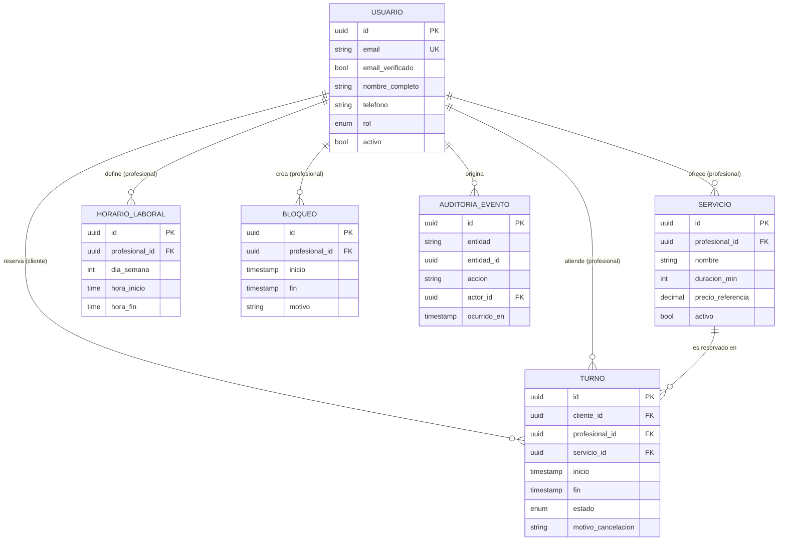

# spec.md — Sistema de Gestión de Turnos y Reservas de Servicios Profesionales

| Campo | Valor |
|---|---|
| Versión | 0.2.1 (MVP · Fase 2: arquitectura desacoplada) |
| Estado | Borrador para revisión |
| Metodología | Spec-Driven Development (SDD) |
| Fecha | 2026-10-27 |
| Cambios respecto de 0.1.0 | Ver §11 (Historial de cambios) |

> Este documento es el **contrato del sistema**. Todo código, test y decisión de diseño debe poder trazarse a una sección de este archivo. Si el código y la spec divergen, se corrige primero la spec y luego el código.

Palabras clave normativas: **DEBE** (obligatorio), **NO DEBE** (prohibido), **PUEDE** (opcional), según RFC 2119.

---

## 1. Alcance del MVP

### 1.1 Objetivo
Permitir que clientes reserven turnos con profesionales para servicios con duración definida, y que los profesionales/administradores gestionen su agenda sin conflictos.

### 1.2 Incluido (In scope)

| ID | Capacidad |
|---|---|
| F-01 | Registro e inicio de sesión de usuarios (email + contraseña). |
| F-02 | Catálogo público de servicios (nombre, descripción, duración, precio de referencia, profesional). |
| F-03 | Consulta de disponibilidad por servicio y fecha (slots libres calculados). |
| F-04 | Reserva de turno por parte del Cliente. |
| F-05 | Consulta de "Mis turnos" (próximos e históricos) del Cliente. |
| F-06 | Cancelación de turno propio por el Cliente (sujeta a RN-01). |
| F-07 | Gestión de servicios por el Profesional (alta, edición, baja lógica). |
| F-08 | Definición de horario laboral semanal recurrente del Profesional. |
| F-09 | Bloqueo de rangos horarios (vacaciones, almuerzo, imprevistos). |
| F-10 | Vista de agenda diaria/semanal con todos los turnos del Profesional. |
| F-11 | Cancelación de turno por el Profesional/Administrador (sin restricción de ventana, con motivo). |
| F-12 | Métricas básicas: turnos por período, tasa de cancelación, servicios más reservados, ocupación. |
| F-13 | Notificación por email de confirmación y cancelación. |

### 1.3 Excluido (Out of scope)

- Pagos en línea, señas, reembolsos y facturación.
- Reprogramación directa de turnos (el MVP resuelve con cancelar + reservar nuevo).
- Turnos recurrentes / paquetes de sesiones.
- Lista de espera.
- Múltiples sucursales o recursos físicos (salas, equipos).
- Integración con calendarios externos (Google/Outlook), recordatorios por SMS/WhatsApp.
- Login social / SSO, autenticación multifactor.
- Aplicación móvil nativa (el MVP es web responsive).
- Multi-idioma y multi-moneda (MVP: español, una moneda).
- Reseñas y calificaciones.
- Multi-tenancy (una sola organización por despliegue).

### 1.4 Supuestos

- Una única zona horaria de operación por despliegue (configurable); los instantes se almacenan en UTC.
- Un turno pertenece a **un** profesional y **un** servicio.
- Un profesional atiende un solo turno a la vez (capacidad = 1).
- El cliente final reserva con cuenta registrada (no hay reserva anónima).

---

## 2. Matriz de Roles y Permisos (RBAC)

### 2.1 Roles

| Rol | Descripción |
|---|---|
| `CLIENTE` | Usuario final que reserva servicios. |
| `PROFESIONAL` | Presta servicios; administra su propia agenda y servicios. |
| `ADMIN` | Gestiona toda la operación: todos los profesionales, servicios y usuarios. |
| Anónimo | Visitante sin sesión (solo lectura del catálogo). |

> Para el MVP, `PROFESIONAL` y `ADMIN` comparten el panel de gestión; `ADMIN` amplía el alcance a **todos** los profesionales.

### 2.2 Matriz de permisos

Leyenda: ✅ permitido · ❌ prohibido · 🔒 solo sobre recursos propios

| Recurso / Acción | Anónimo | CLIENTE | PROFESIONAL | ADMIN |
|---|:-:|:-:|:-:|:-:|
| Ver catálogo de servicios | ✅ | ✅ | ✅ | ✅ |
| Ver disponibilidad (slots libres) | ✅ | ✅ | ✅ | ✅ |
| Registrarse / iniciar sesión | ✅ | — | — | — |
| Crear turno | ❌ | ✅ (para sí) | ❌ | ✅ (en nombre de un cliente) |
| Ver turno | ❌ | 🔒 | 🔒 (de su agenda) | ✅ |
| Cancelar turno | ❌ | 🔒 (sujeto a RN-01) | 🔒 (sin ventana mínima) | ✅ (sin ventana mínima) |
| Editar datos de contacto propios | ❌ | 🔒 | 🔒 | ✅ |
| Crear/editar/desactivar servicios | ❌ | ❌ | 🔒 | ✅ |
| Definir horario laboral | ❌ | ❌ | 🔒 | ✅ |
| Bloquear / desbloquear rangos horarios | ❌ | ❌ | 🔒 | ✅ |
| Ver agenda completa | ❌ | ❌ | 🔒 | ✅ |
| Ver métricas | ❌ | ❌ | 🔒 (propias) | ✅ (globales) |
| Gestionar usuarios y roles | ❌ | ❌ | ❌ | ✅ |

### 2.3 Reglas de autorización

- **RBAC-01**: Toda operación DEBE verificar rol **y** propiedad del recurso en el backend; la UI nunca es la barrera de seguridad.
- **RBAC-02**: Un acceso a un recurso ajeno DEBE responder `404` (no `403`) para no revelar su existencia a un `CLIENTE`.
- **RBAC-03**: El rol se asigna únicamente por un `ADMIN`; el auto-registro siempre crea `CLIENTE`.
- **RBAC-04**: Un `CLIENTE` NO DEBE poder ver datos de contacto de otros clientes. El `PROFESIONAL` solo ve los datos de contacto de clientes con turnos en su agenda.

---

## 3. Reglas Invariantes del Negocio

Las siguientes reglas son **no negociables**: se validan en el backend, y la base de datos DEBE reforzarlas con restricciones cuando sea técnicamente posible. Ninguna regla puede ser omitida por la UI ni por un rol (salvo excepción explícita indicada).

> **Nomenclatura INV.** A partir de la v0.2.0 las reglas que gobiernan el backend también se citan como `INV-xx`. `INV-01` ≡ `RN-01` e `INV-02` ≡ `RN-02`: son alias y su texto es **inmutable** (no se modifica en esta versión). `INV-03` es nueva (ver más abajo). Las demás reglas RN-03 a RN-08 siguen vigentes sin cambios.

### RN-01 (INV-01) — Ventana mínima de cancelación

- Un `CLIENTE` NO DEBE cancelar un turno si faltan **menos de 2 horas** para su `inicio`.
- Valor configurable (`CANCELLATION_WINDOW_HOURS`, default `2`); el cálculo usa `inicio - ahora(UTC)`.
- Un turno ya iniciado, finalizado o cancelado NO DEBE ser cancelable.
- **Excepción**: `PROFESIONAL`/`ADMIN` PUEDEN cancelar fuera de ventana, con motivo obligatorio, y el cliente DEBE ser notificado.
- Respuesta ante violación: error `CANCELLATION_WINDOW_EXPIRED` (HTTP 409).

### RN-02 (INV-02) — Prohibición de doble reserva y solapamiento

- Para un mismo profesional, dos turnos en estado activo (`CONFIRMADO`) NO DEBEN solaparse en el tiempo.
- Se define el solapamiento sobre intervalos semiabiertos `[inicio, fin)`: dos turnos A y B se solapan si `A.inicio < B.fin` **y** `B.inicio < A.fin`. Turnos contiguos (`A.fin == B.inicio`) son válidos.
- Un turno NO DEBE solaparse con un bloqueo horario (RN-05) ni quedar fuera del horario laboral del profesional.
- Un mismo cliente NO DEBE tener dos turnos activos solapados (aunque sean con distintos profesionales).
- **Garantía ante concurrencia**: la verificación DEBE ser atómica. Se exige restricción a nivel de base de datos (p. ej. `EXCLUDE USING gist` sobre rango temporal por profesional en PostgreSQL, o transacción con bloqueo + índice único equivalente). Una validación solo en la aplicación NO es suficiente.
- Los turnos `CANCELADO` NO participan del control de solapamiento (el slot se libera).
- Respuesta ante violación: error `SLOT_UNAVAILABLE` (HTTP 409).

### RN-03 — Validación obligatoria de datos de contacto

- Para crear un turno, el `CLIENTE` DEBE tener un perfil con: **nombre completo** (2–100 caracteres), **email válido** (RFC 5322 simplificado, único por usuario) y **teléfono** válido en formato E.164 o equivalente local normalizado.
- El email DEBE estar **verificado** (enlace de confirmación) antes de la primera reserva.
- La reserva NO DEBE persistirse si algún dato de contacto falta o es inválido (error `INVALID_CONTACT`, HTTP 422).
- Los datos se normalizan (trim, minúsculas en email, teléfono a E.164) antes de validar y guardar.

### RN-04 — Integridad temporal del turno

- `inicio` DEBE ser estrictamente futuro respecto a `ahora` al momento de crear el turno, con una **antelación mínima** configurable (default: 1 hora).
- `fin = inicio + duración del servicio`; el cliente NO DEBE enviar `fin` (se calcula en servidor).
- El `inicio` DEBE estar alineado a la grilla de slots del profesional (default: 15 min).
- Existe un **horizonte máximo de reserva** (default: 60 días).
- Todos los instantes se almacenan en UTC y se muestran en la zona horaria de operación.

### RN-05 — Bloqueos horarios

- Un bloqueo es un rango `[inicio, fin)` del profesional en el que no se pueden crear turnos.
- Crear un bloqueo sobre un rango con turnos activos DEBE ser rechazado con listado de conflictos, **salvo** que el profesional confirme cancelarlos (lo cual aplica la excepción de RN-01 y notifica a los clientes).

### RN-06 — Ciclo de vida del turno

Estados: `CONFIRMADO` → `CANCELADO` | `COMPLETADO` | `AUSENTE`.

| Transición | Quién | Condición |
|---|---|---|
| (nuevo) → `CONFIRMADO` | Cliente / Admin | Cumple RN-02, RN-03, RN-04 |
| `CONFIRMADO` → `CANCELADO` | Cliente | Cumple RN-01 |
| `CONFIRMADO` → `CANCELADO` | Profesional / Admin | Motivo obligatorio |
| `CONFIRMADO` → `COMPLETADO` | Profesional / Admin | `ahora ≥ inicio` |
| `CONFIRMADO` → `AUSENTE` | Profesional / Admin | `ahora ≥ fin` |

- Los estados `CANCELADO`, `COMPLETADO` y `AUSENTE` son **terminales**; ninguna transición sale de ellos.
- Un turno NO DEBE eliminarse físicamente; el historial es inmutable (solo cambia de estado).

### RN-07 — Integridad de catálogo

- Un servicio con turnos futuros activos NO DEBE eliminarse; solo desactivarse (baja lógica), lo cual impide nuevas reservas sin afectar las existentes.
- La duración de un servicio DEBE ser múltiplo de la grilla de slots y estar entre 15 min y 8 h.
- Modificar la duración de un servicio NO altera turnos ya confirmados.

### RN-08 — Trazabilidad

- Toda creación, cancelación y cambio de estado DEBE registrar: actor, rol, instante UTC y motivo (si aplica) en un log de auditoría inmutable.

### INV-03 — Persistencia real

- Todo turno creado o modificado (creación, cancelación, cambio de estado) DEBE persistirse de forma **atómica** en una base de datos relacional: o se guardan todos los cambios de la operación, o ninguno.
- Los turnos DEBEN sobrevivir al reinicio del sistema (backend y frontend). Ningún dato de dominio puede residir únicamente en la memoria del cliente (navegador) ni del proceso del servidor.
- La verificación de `INV-01` e `INV-02` DEBE ejecutarse **dentro de la misma transacción** que la escritura, de modo que dos solicitudes concurrentes por el mismo horario no puedan confirmarse ambas. En un motor sin restricción de exclusión de rangos (p. ej. SQLite), la atomicidad se logra con transacción de escritura exclusiva (`BEGIN IMMEDIATE`) o un bloqueo equivalente, según lo admite RN-02.
- Si la escritura falla, el sistema DEBE responder error y NO DEBE dejar el turno a medias.
- El esquema DEBE limitarse a las entidades y atributos de la §4 (ver §12, directiva de abstención).

---

## 4. Modelo de Datos Conceptual

### 4.1 Entidades principales

#### Usuario
| Atributo | Tipo | Restricciones |
|---|---|---|
| `id` | UUID | PK |
| `email` | texto | Único, obligatorio, normalizado |
| `email_verificado` | booleano | Default `false` |
| `password_hash` | texto | Obligatorio (nunca en claro) |
| `nombre_completo` | texto | Obligatorio, 2–100 |
| `telefono` | texto | Obligatorio, E.164 |
| `rol` | enum | `CLIENTE` \| `PROFESIONAL` \| `ADMIN` |
| `activo` | booleano | Default `true` |
| `creado_en` | timestamp UTC | |

#### Servicio
| Atributo | Tipo | Restricciones |
|---|---|---|
| `id` | UUID | PK |
| `profesional_id` | UUID | FK → Usuario (rol `PROFESIONAL`) |
| `nombre` | texto | Obligatorio |
| `descripcion` | texto | Opcional |
| `duracion_min` | entero | 15–480, múltiplo de la grilla |
| `precio_referencia` | decimal | ≥ 0, informativo |
| `activo` | booleano | Baja lógica (RN-07) |

#### Turno
| Atributo | Tipo | Restricciones |
|---|---|---|
| `id` | UUID | PK |
| `cliente_id` | UUID | FK → Usuario (rol `CLIENTE`) |
| `profesional_id` | UUID | FK → Usuario (rol `PROFESIONAL`) |
| `servicio_id` | UUID | FK → Servicio |
| `inicio` | timestamp UTC | Futuro al crear (RN-04) |
| `fin` | timestamp UTC | Calculado: `inicio + duración` |
| `estado` | enum | Ver RN-06 |
| `motivo_cancelacion` | texto | Obligatorio si lo cancela Profesional/Admin |
| `cancelado_por_id` | UUID | FK → Usuario, nullable |
| `creado_en` / `actualizado_en` | timestamp UTC | |

*Restricción clave*: exclusión de rangos `[inicio, fin)` por `profesional_id` cuando `estado = CONFIRMADO` (RN-02).

#### Entidades de soporte

| Entidad | Atributos clave | Propósito |
|---|---|---|
| **HorarioLaboral** | `id`, `profesional_id`, `dia_semana` (0–6), `hora_inicio`, `hora_fin` | Disponibilidad semanal recurrente (F-08). |
| **Bloqueo** | `id`, `profesional_id`, `inicio`, `fin`, `motivo` | Rangos no reservables (F-09, RN-05). |
| **AuditoriaEvento** | `id`, `entidad`, `entidad_id`, `accion`, `actor_id`, `rol`, `ocurrido_en`, `detalle` | Trazabilidad inmutable (RN-08). |

### 4.2 Relaciones y cardinalidad

```
Usuario (PROFESIONAL) 1 ──── N Servicio
Usuario (PROFESIONAL) 1 ──── N HorarioLaboral
Usuario (PROFESIONAL) 1 ──── N Bloqueo
Usuario (PROFESIONAL) 1 ──── N Turno      (como profesional atendiendo)
Usuario (CLIENTE)     1 ──── N Turno      (como cliente reservando)
Servicio              1 ──── N Turno
Usuario               1 ──── N AuditoriaEvento (actor)
```



### 4.3 Invariantes de integridad referencial

- `Turno.profesional_id` DEBE coincidir con `Servicio.profesional_id` del `servicio_id` asociado.
- `Turno.cliente_id` y `Turno.profesional_id` DEBEN ser usuarios distintos.
- Ninguna FK usa borrado en cascada sobre `Turno`; el historial se preserva (RN-06, RN-07).

---

## 5. Métricas del MVP (F-12)

| Métrica | Definición |
|---|---|
| Turnos por período | Conteo de turnos `CONFIRMADO`/`COMPLETADO` agrupados por día/semana/mes. |
| Tasa de cancelación | `CANCELADO / total creados` en el período, con desglose por quién canceló. |
| Tasa de ausentismo | `AUSENTE / (COMPLETADO + AUSENTE)`. |
| Ocupación | Minutos reservados / minutos disponibles (horario laboral − bloqueos). |
| Top servicios | Ranking de servicios por cantidad de turnos. |

Alcance: el `PROFESIONAL` ve solo las suyas; el `ADMIN` ve las globales y por profesional.

---

## 6. Requisitos No Funcionales (mínimos del MVP)

- **Seguridad**: contraseñas con hash adaptativo (argon2/bcrypt), HTTPS obligatorio, sesiones con expiración, protección CSRF/XSS, rate limiting en login y reserva.
- **Consistencia**: la creación de turno es transaccional y atómica (RN-02).
- **Rendimiento**: consulta de disponibilidad < 500 ms p95 con hasta 50 profesionales.
- **Privacidad**: datos de contacto accesibles solo según RBAC-04; cumplimiento de la normativa local de protección de datos personales.
- **Disponibilidad**: objetivo 99,5 % mensual (sin HA en MVP).
- **Accesibilidad**: WCAG 2.1 AA en flujos de reserva.

---

## 7. Catálogo de Errores de Dominio

| Código | HTTP | Origen |
|---|---|---|
| `SLOT_UNAVAILABLE` | 409 | RN-02, RN-05 |
| `CANCELLATION_WINDOW_EXPIRED` | 409 | RN-01 |
| `INVALID_CONTACT` | 422 | RN-03 |
| `EMAIL_NOT_VERIFIED` | 403 | RN-03 |
| `INVALID_TIME_RANGE` | 422 | RN-04 |
| `INVALID_STATE_TRANSITION` | 409 | RN-06 |
| `SERVICE_HAS_ACTIVE_BOOKINGS` | 409 | RN-07 |
| `FORBIDDEN` / `NOT_FOUND` | 403 / 404 | RBAC-01, RBAC-02 |
| `INVALID_REQUEST` | 422 | §11: cuerpo o parámetros mal formados (validación de esquema, motivo faltante) |

---

## 8. Criterios de Aceptación (muestra Given/When/Then)

1. **Doble reserva**: *Dado* un turno `CONFIRMADO` de 10:00–10:30 con el profesional P, *cuando* otro cliente reserva 10:15–10:45 con P, *entonces* el sistema responde `SLOT_UNAVAILABLE` y no persiste nada.
2. **Concurrencia**: *Dado* dos solicitudes simultáneas por el mismo slot, *entonces* exactamente una se confirma y la otra recibe `SLOT_UNAVAILABLE`.
3. **Contigüidad**: *Dado* un turno 10:00–10:30, *cuando* se reserva 10:30–11:00, *entonces* se confirma.
4. **Cancelación en ventana**: *Dado* un turno que inicia en 3 h, *cuando* el cliente cancela, *entonces* pasa a `CANCELADO` y el slot queda libre.
5. **Cancelación fuera de ventana**: *Dado* un turno que inicia en 1 h 59 min, *cuando* el cliente cancela, *entonces* `CANCELLATION_WINDOW_EXPIRED`.
6. **Contacto inválido**: *Dado* un cliente sin teléfono válido, *cuando* intenta reservar, *entonces* `INVALID_CONTACT`.
7. **Aislamiento**: *Dado* el turno T del cliente A, *cuando* el cliente B consulta T, *entonces* recibe `404`.
8. **Bloqueo con conflicto**: *Dado* un turno confirmado dentro de un rango, *cuando* el profesional intenta bloquearlo sin confirmar, *entonces* el sistema lista los conflictos y no crea el bloqueo.
9. **Persistencia (INV-03)**: *Dado* un turno creado con `POST /api/turnos`, *cuando* se reinicia el backend, *entonces* `GET /api/turnos` lo sigue devolviendo con los mismos datos.
10. **Atomicidad (INV-03)**: *Dado* un fallo durante la escritura de un turno, *entonces* no queda ningún registro parcial en `turnos.db`.
11. **Contrato REST**: *Dado* un `POST /api/turnos/{id}/cancelar` a menos de 2 h del inicio por un `CLIENTE`, *entonces* responde `409` con `CANCELLATION_WINDOW_EXPIRED` y el turno sigue `CONFIRMADO`.

---

## 9. Decisiones Abiertas (a resolver antes de implementar)

| # | Pregunta | Propuesta por defecto |
|---|---|---|
| D-01 | ¿Un cliente puede tener límite de turnos activos simultáneos? | Sin límite en MVP |
| D-02 | ¿Los Profesionales pueden ser dados de alta por auto-registro? | No, solo vía `ADMIN` |
| D-03 | ¿Política de cancelaciones reiteradas / penalización? | Fuera del MVP |
| D-04 | Stack tecnológico y motor de BD (requiere soporte de exclusión de rangos) | PostgreSQL. **Fase 2:** se usa SQLite local (`turnos.db`) y FastAPI; la exclusión de rangos se resuelve por transacción exclusiva (INV-03). PostgreSQL queda como destino de producción. |
| D-06 | Autenticación real (F-01) aún no existe en Fase 2: ¿cómo se identifica al actor en los endpoints? | Provisoriamente por `cliente_id` / `cancelado_por_id` en el cuerpo. Es un atajo de la Fase 2: NO cumple RBAC-01 y se reemplaza al implementar F-01. |
| D-05 | ¿Confirmación automática o aprobación manual del profesional? | Automática |

---

## 10. Trazabilidad (Spec → Código → Test)

| Spec | Código (a completar) | Test (a completar) |
|---|---|---|
| RN-01 | — | Criterios 4, 5 |
| RN-02 | — | Criterios 1, 2, 3 |
| RN-03 | — | Criterio 6 |
| RBAC-02 | — | Criterio 7 |
| INV-03 | — | Criterios 9, 10 |
| RN-05 | — | Criterio 8 |

---

## 11. Contrato de API REST (Fase 2)

Este contrato gobierna el backend. Formato JSON (`Content-Type: application/json`), instantes en ISO 8601 UTC. Los nombres de campo son **exactamente** los de la §4. Los errores usan el catálogo de la §7 con el cuerpo `{"error": "<CODIGO>", "detalle": "<texto>"}`.

Alcance: solo la entidad `Turno` (lectura y escritura). Servicios y usuarios se leen desde la base; su alta/edición por API queda fuera de esta fase.

### 11.1 `GET /api/turnos` — listar turnos

| Aspecto | Definición |
|---|---|
| Query (opcional) | `cliente_id`, `profesional_id`, `estado` (valores de RN-06) |
| Respuesta `200` | Arreglo de objetos Turno: `id`, `cliente_id`, `profesional_id`, `servicio_id`, `inicio`, `fin`, `estado`, `motivo_cancelacion`, `cancelado_por_id`, `creado_en`, `actualizado_en` |
| Errores | `422 INVALID_REQUEST` si un filtro tiene formato o valor inválido |

Los datos provienen siempre de la base (INV-03), nunca de caché en memoria del proceso.

### 11.2 `POST /api/turnos` — crear reserva

| Aspecto | Definición |
|---|---|
| Cuerpo | `cliente_id` (UUID), `servicio_id` (UUID), `inicio` (timestamp UTC) |
| Calculado por el servidor | `id`, `profesional_id` (= `Servicio.profesional_id`), `fin` (= `inicio` + `duracion_min`), `estado = CONFIRMADO`, `creado_en`, `actualizado_en`. El cliente NO DEBE enviar `fin` (RN-04) |
| Respuesta `201` | Objeto Turno creado |
| `409 SLOT_UNAVAILABLE` | Solapamiento con otro turno `CONFIRMADO` del profesional o del cliente (INV-02) |
| `422 INVALID_TIME_RANGE` | `inicio` no futuro, sin la antelación mínima, fuera de grilla o del horizonte (RN-04) |
| `422 INVALID_CONTACT` / `403 EMAIL_NOT_VERIFIED` | Datos de contacto del cliente inválidos o email sin verificar (RN-03) |
| `404 NOT_FOUND` | `cliente_id` o `servicio_id` inexistente |

La validación y la inserción ocurren en una única transacción (INV-03).

### 11.3 `POST /api/turnos/{id}/cancelar` — cancelar reserva

| Aspecto | Definición |
|---|---|
| Parámetro de ruta | `id` (UUID del turno) |
| Cuerpo | `cancelado_por_id` (UUID del actor); `motivo_cancelacion` (obligatorio si el actor es `PROFESIONAL`/`ADMIN`) |
| Efecto | `estado: CONFIRMADO → CANCELADO`, se completan `motivo_cancelacion`, `cancelado_por_id` y `actualizado_en`; el slot queda libre (RN-02) |
| Respuesta `200` | Objeto Turno actualizado |
| `409 CANCELLATION_WINDOW_EXPIRED` | El actor es `CLIENTE` y faltan menos de 2 h para `inicio` (INV-01) |
| `409 INVALID_STATE_TRANSITION` | El turno no está `CONFIRMADO` (RN-06) |
| `404 NOT_FOUND` | Turno inexistente |

`PROFESIONAL`/`ADMIN` pueden cancelar fuera de ventana con motivo (excepción de INV-01). El turno nunca se elimina físicamente (RN-06).

### 11.4 Requisitos transversales

- CORS habilitado para el origen del frontend (ver `plan.md`).
- Códigos HTTP y nombres de error idénticos a la §7.
- Identificación del actor provisoria según D-06.

---

## 12. Directiva de abstención (grounding)

- El esquema de `turnos.db` y los contratos de la API SOLO PUEDEN usar las entidades, tablas y campos definidos en la §4. Está prohibido inventar tablas, columnas, enums o campos que no figuren allí.
- Si una necesidad no está cubierta por la §4, se registra en la §9 como decisión abierta y se resuelve **en el spec primero**, antes de tocar código.
- Tablas permitidas en la Fase 2: `Usuario`, `Servicio`, `Turno` (obligatorias para este contrato) y, si se implementan sus reglas, `HorarioLaboral`, `Bloqueo` y `AuditoriaEvento`. Ninguna otra.

---

## 13. Historial de cambios

| Versión | Fecha | Cambios |
|---|---|---|
| 0.1.0 | 2026-10-26 | Versión inicial del MVP. |
| 0.2.1 | 2026-10-27 | Se agrega `INVALID_REQUEST` (422) al catálogo §7 y se usa en §11.1. |
| 0.2.0 | 2026-10-27 | Alias `INV-01`/`INV-02` (texto inmutable); nueva `INV-03` (persistencia real); contrato REST de `/api/turnos` (§11); directiva de abstención (§12); decisiones D-04 (resuelta para Fase 2) y D-06; criterios de aceptación 9 a 11. |
